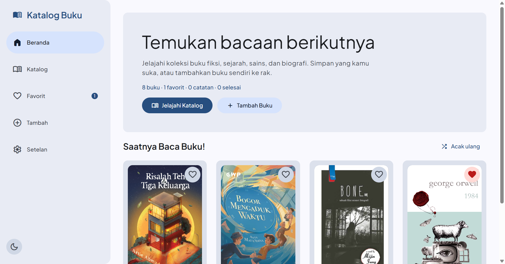
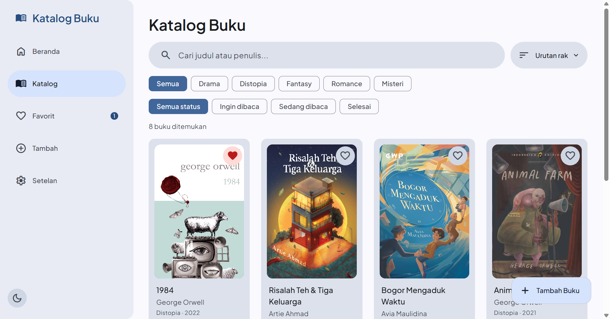
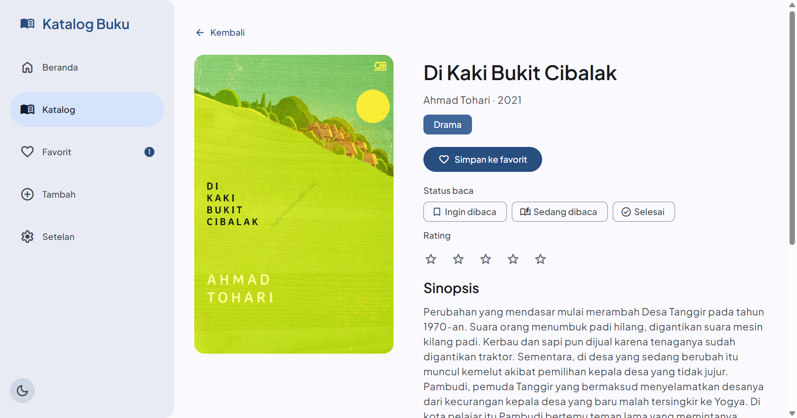
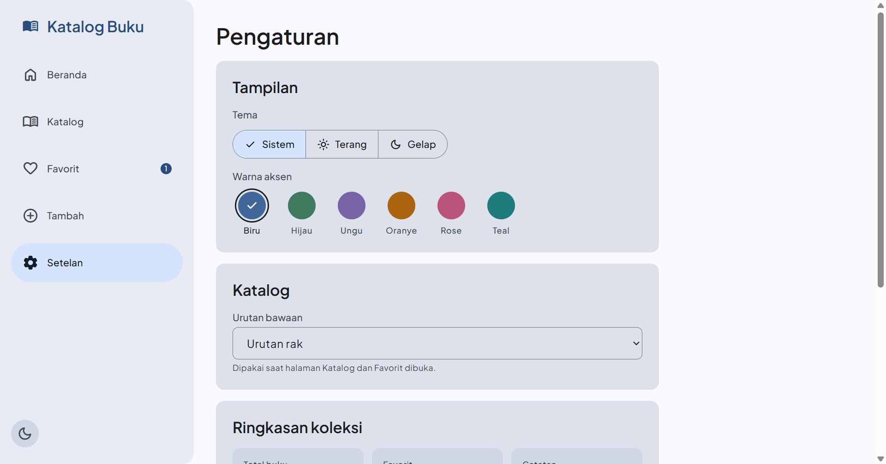

# Rak Buku - Katalog Buku Digital


**Rak Buku** adalah aplikasi web katalog buku interaktif yang memungkinkan pengguna untuk menjelajahi, mencari, memfilter, dan menyimpan buku favorit. Aplikasi ini juga dilengkapi fitur catatan pribadi, status baca, *rating*, dukungan tema gelap/terang, pilihan warna aksen, serta cadangan data (ekspor/impor JSON). Seluruh data disimpan di `localStorage`, sehingga aplikasi berjalan sepenuhnya di sisi klien tanpa *backend*.

---

## Tugas Praktikum

- **Nama:** Wellington Covernikus Simangunsong
- **NIM:** 25071102434
- **Kelas:** TI-C
- **Mata Kuliah:** Praktikum Desain dan Pemrograman Web

---

## Screenshot

### Beranda

Halaman utama dengan hero statistik koleksi, bagian "Lanjutkan membaca", dan 4 buku pilihan acak.



### Katalog

Pencarian judul/penulis, filter genre, filter status baca, dan pengurutan (rak, terbaru, terlama, judul, penulis).



### Detail Buku

Cover, sinopsis, tombol favorit, status baca, rating bintang, serta catatan pribadi per buku.



### Pengaturan

Tema (sistem/terang/gelap), warna aksen, urutan bawaan, ringkasan koleksi, dan ekspor/impor JSON.



---

## Fitur Utama

- Beranda interaktif dengan statistik koleksi (total buku, favorit, catatan, selesai), bagian "Lanjutkan membaca" berdasarkan status baca, dan 4 buku pilihan yang dapat diacak ulang.
- Cari berdasarkan judul atau penulis, filter *genre*, filter status baca, serta 5 mode pengurutan (urutan rak, terbaru, terlama, judul A–Z, penulis A–Z).
- Detail buku meliputi sinopsis lengkap, *toggle* favorit, status baca (ingin/sedang/selesai), *rating* 1–5 bintang, dan catatan pribadi.
- Catatan pribadi per buku (maks. 500 karakter) dengan dukungan `Ctrl/Cmd+Enter` untuk menyimpan, serta *undo* saat menghapus catatan lewat *toast*.
- Daftar favorit dengan pencarian, pengurutan, dan *badge* jumlah favorit pada navigasi.
- Tambah & ubah buku sendiri menggunakan *form* dengan validasi judul, penulis, *genre*, tahun, dan URL gambar, lengkap dengan pratinjau cover dan pilihan warna cover.
- Buku tambahan dapat diedit dan dihapus. Menghapus buku otomatis membersihkan favorit, catatan, status, dan rating terkait.
- Pengaturan berisi tema sistem/terang/gelap, 6 warna aksen, urutan bawaan, ringkasan statistik koleksi, ekspor/impor JSON (mode gabung/ganti), dan reset data.
- Desain responsif, mobile memakai `Bottom Navigation`, desktop memakai `Side Navigation`.
- Buku tambahan, favorit, catatan, status baca, rating, tema, aksen, dan urutan tersimpan di `localStorage` sehingga tidak hilang saat halaman di-*refresh*.

---

## Teknologi yang Digunakan

- **Frontend Framework:** React.js (dibangun dengan Vite)
- **Routing:** React Router DOM v6
- **Styling:** CSS3 dengan Custom Properties (Material Design 3 Tokens)
- **State Management:** React Hooks (`useState`, `useEffect`, `useLayoutEffect`, `useMemo`, `useCallback`)
- **Custom Hooks:** `useLocalStorage` (sinkronisasi state ↔ `localStorage`), `useTema` (tema sistem/terang/gelap), `useAksen` (warna aksen)
- **Icons:** Material Symbols Rounded
- **Penyimpanan Data:** `localStorage` (tanpa backend)

---

## Cara Menjalankan Proyek

Pastikan [Node.js](https://nodejs.org/) telah terinstal di perangkat yang digunakan.

1. **Clone repository ini**
   
   ```bash
   git clone https://github.com/Wellin-Rttf/Tugas-Praktikum-DPW-Web-Katalog-Buku.git
   cd 'Tugas-Praktikum-DPW-Web-Katalog-Buku'
   ```

2. **Instal dependensi**
   
   ```bash
   npm install
   ```

3. **Jalankan aplikasi di mode development**
   
   ```bash
   npm run dev
   ```

4. **Buka di browser**
   
   Buka tautan yang muncul di terminal (misalnya `http://localhost:5173`).


